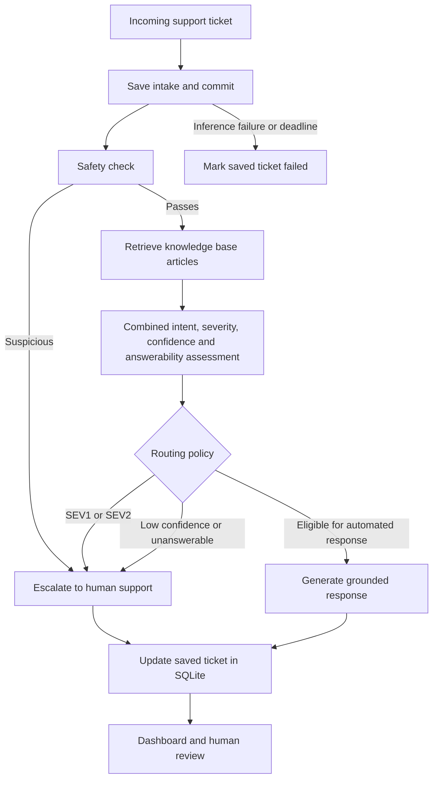

# SupportFlow — AI Support Ticket Triage & Auto-Escalation Engine

SupportFlow classifies incoming support tickets, retrieves relevant knowledge base articles, checks whether an automated answer is appropriate, and escalates tickets that require human attention.

The React dashboard supports email uploads, manual ticket entry, ticket history, human review, severity updates, and analytics. The supported scope is one issue per ticket.

## Features

- Classifies tickets into support intent categories.
- Assigns severity from `SEV1` to `SEV5`.
- Always escalates `SEV1` and `SEV2` incidents.
- Escalates tickets with confidence below 80%.
- Checks whether the knowledge base supports an automated response.
- Flags potential prompt injection attempts.
- Generates responses using retrieved knowledge base content.
- Stores ticket history and human feedback in SQLite.
- Processes sample tickets through the same pipeline used by the API.

## Architecture



### Pipeline components

| Component          | Responsibility                                                               |
| ------------------ | ---------------------------------------------------------------------------- |
| `backend/agent/safety.py`        | Detect potential prompt injection attempts.                                  |
| `backend/rag/vector.py`        | Create the knowledge base vector store using Ollama embeddings and ChromaDB. |
| `backend/rag/retriever.py`     | Retrieve knowledge base articles for a ticket.                               |
| `backend/agent/classifier.py`    | Determine category, severity, confidence, answerability, and reasoning.                     |
| `backend/agent/router.py`        | Apply escalation and automatic reply policies.                               |
| `backend/agent/responder.py`     | Generate a customer-facing response from the retrieved context.              |
| `backend/agent/triage.py`        | Coordinate the shared ticket processing pipeline.                            |
| `backend/api.py`           | Expose API endpoints and persist ticket records.                             |
| `backend/evaluation/run_batch.py`          | Run the shared pipeline against the sample dataset.                          |

## Categories

The classifier uses these intent categories:

- `password_reset`
- `billing_question`
- `shipping_delay`
- `login_issues`
- `other`

Routing decisions are separate from intent categories:

- `AUTO_REPLY`
- `ESCALATE`

## Severity and SLA policy

| Severity | Typical impact                                                            | SLA target | Routing policy                                          |
| -------- | ------------------------------------------------------------------------- | ---------- | ------------------------------------------------------- |
| `SEV1`   | Widespread outage, major security breach, or critical service failure     | 4 hours    | Always escalate                                         |
| `SEV2`   | Major disruption affecting multiple users without an immediate workaround | 1 day      | Always escalate                                         |
| `SEV3`   | Standard functional issue or individual problem                           | 3 days     | Automatic reply only when other eligibility checks pass |
| `SEV4`   | Minor issue or general question                                           | 4 days     | Automatic reply only when other eligibility checks pass |
| `SEV5`   | Informational inquiry or feature request                                  | 5 days     | Automatic reply only when other eligibility checks pass |

A ticket must pass the safety, confidence, and answerability checks before it can receive an automated response.

When a `SEV4` or `SEV5` ticket requires escalation, the pipeline promotes it to `SEV3` with a three-day SLA target.

SLA values are recorded targets. Operational alerting and enforcement require integration with your support processes.

## Tech stack

### Backend

- Python 3.10+
- FastAPI
- Pydantic
- SQLite
- LangChain
- Ollama
- ChromaDB
- Pandas
- Pytest

### Frontend

- React
- Vite
- React Router
- Lucide React
- CSS

## Project structure

```text
support-triage/
├── backend/
│   ├── api.py                  # HTTP routes and request validation
│   ├── storage.py              # SQLite schema and transactions
│   ├── jobs.py                 # Attempts, retry and recovery
│   ├── audit.py                # Evidence and version snapshots
│   ├── auth.py                 # API credential checks
│   ├── config.py               # Settings and paths
│   ├── agent/                  # AI triage, policy, routing and replies
│   ├── rag/                    # Knowledge loading, vectors and retrieval
│   ├── knowledgebase/          # Original FAQ documents
│   ├── evaluation/             # run_batch.py, scoring and benchmarks
│   ├── data/                   # Evaluation inputs and labels
│   └── test/                   # Backend tests and isolated browser helper
├── frontend/
│   ├── public/support-corgi.png
│   └── src/
│       ├── App.jsx             # Routes and shared layout
│       ├── pages/              # Inbox, new ticket, details and insights
│       ├── components/         # Visible UI building blocks
│       ├── services/api.js     # HTTP requests
│       └── styles/             # Shared and page-specific CSS
├── docs/code-guide.md          # Where to start reading
├── test_emails/
└── pytest.ini
```

See [the beginner code guide](docs/code-guide.md) for each file's purpose and a
suggested reading order.

Runtime databases and evaluation exports are created in `backend/output/`.
The batch runner uses `backend/data/sample_tickets.csv`, containing 30 development
cases with separate intent, severity and routing labels. See `backend/data/README.md`
for source provenance, challenge cases, holdouts and the optional demo SQLite seed.


The backend creates runtime output files when needed. Do not commit generated databases, result files, environment secrets, or bytecode.

## Getting started

### Prerequisites

Install:

1. Python 3.10 or newer.
2. A Node.js version compatible with the Vite version in `frontend/package.json`.
3. npm.
4. Ollama.

### 1. Install both Ollama models

SupportFlow uses two different models:

| Purpose                                            | Model               | Used by                                          |
| -------------------------------------------------- | ------------------- | ------------------------------------------------ |
| Text generation, classification, and answerability | `llama3.2`          | Combined classifier and responder |
| Knowledge base and ticket embeddings               | `mxbai-embed-large` | `backend/rag/vector.py`                              |

Download both models:

```bash
ollama pull llama3.2
ollama pull mxbai-embed-large
```

Confirm that both are installed:

```bash
ollama list
```

The list should include:

```text
llama3.2:latest
mxbai-embed-large:latest
```

Downloading only `llama3.2` is insufficient. Retrieval also requires `mxbai-embed-large`.

Keep Ollama running while using the application. If it is not already running through the desktop application or a background service, start it:

```bash
ollama serve
```

The default Ollama URL is:

```text
http://localhost:11434
```

### 2. Clone the repository

```bash
git clone https://github.com/angelfila2/support-triage.git
cd support-triage
```

### 3. Set up the backend

Open a terminal in the backend directory:

```bash
cd backend
```

Create a virtual environment:

```bash
python -m venv .venv
```

Activate it on Windows PowerShell:

```powershell
.\.venv\Scripts\Activate.ps1
```

Or activate it on Linux/macOS:

```bash
source .venv/bin/activate
```

Install dependencies:

```bash
python -m pip install -r requirements.txt
```

Create a local `backend/.env` before starting. Set `API_WRITE_TOKEN` to a random
value of at least 32 characters; optionally set a distinct `API_READ_TOKEN`.
Generate a value with `python -c "import secrets; print(secrets.token_urlsafe(32))"`.
Environment files stay local and are ignored by Git. The local frontend server
reads the backend credential automatically; the dashboard needs no token entry.

Return to the repository root and start the backend:

```bash
cd ..
python -m uvicorn backend.api:app --reload --host 127.0.0.1 --port 8000
```

Backend URLs:

- API: http://127.0.0.1:8000
- Interactive API documentation: http://127.0.0.1:8000/docs

Knowledge base initialization may take time on the first startup because the documents must be embedded.

### 4. Set up the frontend

Open another terminal from the repository root:

```bash
cd frontend
npm install
```

Create `frontend/.env` locally if you need a different API URL. Environment files are not committed.

The local frontend server forwards requests to this backend URL by default:

```text
http://127.0.0.1:8000
```

To override it, set the following in `frontend/.env`:

```dotenv
VITE_API_URL=http://127.0.0.1:8000
```

Restart the Vite development server after changing environment variables.

Start the frontend:

```bash
npm run dev
```

Open the URL printed by Vite, normally:

```text
http://localhost:5173
```

## Backend configuration

Backend settings are defined in `backend/config.py`.

You can override them using environment variables or a local `backend/.env` file.

Example:

```dotenv
OLLAMA_MODEL=llama3.2
OLLAMA_BASE_URL=http://localhost:11434
CORS_ORIGINS=http://localhost:5173,http://127.0.0.1:5173
```

Supported path overrides include:

- `OUTPUT_DIR`
- `TICKETS_FILE`
- `KNOWLEDGE_BASE_DIR`
- `DATA_DIR`
- `SAMPLE_TICKETS_FILE`
- `TRIAGE_RESULTS_FILE`

Relative path overrides resolve from `backend/`, independent of the terminal directory. Absolute paths remain supported.

The embedding model used by `backend/rag/vector.py` is `mxbai-embed-large`. Keep the installed embedding model aligned with the model configured in that file.

## Using the dashboard

1. The dashboard opens the ticket inbox (`/tickets`), with search, filters and queue views.
2. Select **New ticket** (`/triage`) to type a request or upload an `.eml` email.
3. Review the subject and body, then start triage.
4. Inspect the category, severity, confidence, routing decision and suggested reply.
5. Open a ticket to review the original request, AI assessment and decision evidence.
6. Record classification feedback or agent response notes from ticket details.
7. Open **Insights** (`/analytics`) for aggregate classification and routing statistics.

Example email files are available in `test_emails/`.

## API reference

### Health check

```http
GET /
```

Returns basic application status. `GET /health/live` checks process liveness;
`GET /health/ready` checks SQLite and the required Ollama models, returning 503
until those dependencies are available.

### Triage a ticket

```http
POST /api/triage
```

Request:

```json
{
  "subject": "Password reset link expired",
  "body": "I forgot my password, but the reset link has expired. How can I request another?"
}
```

Example response:

```json
{
  "id": "1",
  "created_at": "2026-01-01T12:00:00",
  "category": "password_reset",
  "urgency": "SEV4",
  "confidence": 95,
  "is_suspicious": false,
  "decision": "AUTO_REPLY",
  "reason": "The knowledge base documents how to request a new password reset link.",
  "response": "Please request a new password reset email from the login page. Password reset links expire after 30 minutes.",
  "retrieved_sources": ["password_reset.md"],
  "sla": "4 days"
}
```

Model-generated fields can vary.

### List tickets

```http
GET /api/tickets
```

Returns `{items, total, limit, offset, summary}`, ordered newest first. The default
page contains 25 tickets; `limit` accepts 1–100 and `offset` starts at zero.
Optional filters: `q`, `category`, `urgency`, `processing_status` and `review`
(`pending`, `correct`, `incorrect`). Summary counts cover all matching records,
not just the current page. For example:

```http
GET /api/tickets?processing_status=failed&limit=25&offset=0
```

`GET /api/analytics` returns aggregates across the full ticket history.
`POST /api/tickets/{ticket_id}/retry` processes a pending or failed ticket under
its existing ID; concurrent or completed-ticket retries return 409.
`GET /api/tickets/{ticket_id}/attempts` returns bounded attempt history with frozen
FAQ evidence, model metadata and code hashes. See [operations](docs/operations.md).

### Retrieve one ticket

```http
GET /api/tickets/{ticket_id}
```

Returns the ticket matching the supplied ID.

Returns `404` if the ticket does not exist.

### Save review feedback

```http
PATCH /api/tickets/{ticket_id}/review
```

Request when the classification is correct:

```json
{
  "analysis_correct": true,
  "corrected_category": null,
  "review_notes": "The category matches the customer's issue."
}
```

Request when the classification is incorrect:

```json
{
  "analysis_correct": false,
  "corrected_category": "login_issues",
  "review_notes": "The customer can reset their password but still cannot sign in."
}
```

A corrected category is required when marking an analysis as incorrect.

### Update response status and severity

```http
PATCH /api/tickets/{ticket_id}/respond
```

Request:

```json
{
  "responded": true,
  "urgency": "SEV3",
  "response_notes": "An agent investigated the issue and contacted the customer."
}
```

Records the response status, severity, SLA, timestamp, and agent notes.

## Batch processing

From the repository root, with the backend virtual environment active and Ollama running:

```bash
python -m backend.evaluation.run_batch
```

The batch runner:

1. Reads `backend/data/sample_tickets.csv` (or `SAMPLE_TICKETS_FILE`).
2. Calls the shared `triage_ticket()` pipeline for each ticket.
3. Prints the results.
4. Writes results to `output/triage_results.csv`.

A successful run should process all 30 sample tickets without errors.

The batch results file is regenerated on each run. It is separate from the SQLite ticket history maintained by the API.

## Evaluation

From the repository root, after generating batch results:

```bash
python -m backend.evaluation.evaluate
```

The evaluator reports separate intent, routing and severity precision, recall and
macro F1, plus critical-incident escalation recall. Expected labels remain separate
from model inputs. These small synthetic/adapted fixtures are development evidence,
not estimates of production accuracy.

## Verifying the embedding setup

Use these checks to confirm that Problem 4 is resolved:

1. Confirm both models are installed:

   ```bash
   ollama list
   ```

2. Confirm Ollama is running.

3. Start the backend:

   ```bash
   # Run from the repository root.
   python -m uvicorn backend.api:app --reload --host 127.0.0.1 --port 8000
   ```

4. Open:

   ```text
   http://127.0.0.1:8000/docs
   ```

5. Submit a password reset ticket through `POST /api/triage`.

The request should complete without a missing embedding model or model-not-found error.

## Running tests

From the repository root, with the backend virtual environment active:

```bash
python -m pytest -q
```

The repository-level `pytest.ini` configures test discovery and package imports.
The same configuration is found when running `python -m pytest test -q` from
`backend/`. Model-output tests use mocked model calls; they do not require Ollama.

## Troubleshooting

### Embedding model not found

If an error mentions `mxbai-embed-large` or a missing embedding model, run:

```bash
ollama pull mxbai-embed-large
```

Confirm installation:

```bash
ollama list
```

Then restart the backend.

### Generation model not found

Install the generation model:

```bash
ollama pull llama3.2
```

If you changed `OLLAMA_MODEL`, install that exact model instead.

### Cannot connect to Ollama

Confirm that Ollama is running:

```bash
ollama list
```

If necessary, start the server:

```bash
ollama serve
```

Check that `OLLAMA_BASE_URL` matches the running Ollama server.

### Frontend cannot connect to the backend

Check that:

- FastAPI is running on port `8000`.
- `VITE_API_URL` points to the backend.
- `CORS_ORIGINS` includes the frontend origin.
- The frontend development server was restarted after environment changes.

### First request is slow

Ollama may need to load the generation and embedding models into memory.

Response times depend on hardware, model loading, and ticket length.

### Batch results file is missing

Generate it first:

```bash
python -m backend.evaluation.run_batch
```

Then run:

```bash
python -m backend.evaluation.evaluate
```

## Policy, access controls and live evaluation

See [P0/P1 fixes and validation](docs/P0-P1-fixes.md) for the policy boundary,
repeated live-model evaluations, metrics and known limits. Automatic customer
responses contain only verified complete FAQ quotations. Unsupported actions
and human-only resolutions are escalated even if a model permits a reply.

Ticket endpoints require bearer credentials by default. Configure `API_WRITE_TOKEN`
and an optional distinct `API_READ_TOKEN` in `backend/.env`. For local development,
the frontend server reads the write credential and forwards API requests automatically.
No credential is stored in browser storage or included in frontend assets.
For an explicitly trusted local demo only, set `AUTH_REQUIRED=false`.
Never publish credentials in frontend environment variables.

The database uses the fresh schema; previous database files are not migrated.
Use a clean `OUTPUT_DIR` for a new installation rather than deleting history.

## Limitations and planned improvements

- Expand independently labelled evaluation and attack coverage.
- Add Docker-based setup.
- Integrate mailbox ingestion and escalation notifications.

Automated responses should be validated against representative support tickets before operational use.

## License

See the repository's license file for applicable terms.


## Automatic local backend connection

Start the backend and run `npm run dev` in `frontend/`. The inbox connects without
a login form, token copying or a Connect API button. Vite reads `backend/.env`
on the server and adds authentication only when forwarding `/api` requests to
the local backend. `/health` is forwarded too, so the header reports readiness.
`npm run preview` supports the same local connection after a build.

Restart both servers after changing backend credentials. `VITE_API_URL`, if set,
is the server's upstream address; browser requests always stay on the app origin.
The automatic proxy binds to loopback and rejects requests from unrelated origins.
Direct API clients still need bearer credentials. Static hosting alone cannot read
`.env`; remote deployments need their own authenticated server-side integration.

Verify the local connection with `node --test test/backend-connection.test.mjs`
from `frontend/`.
