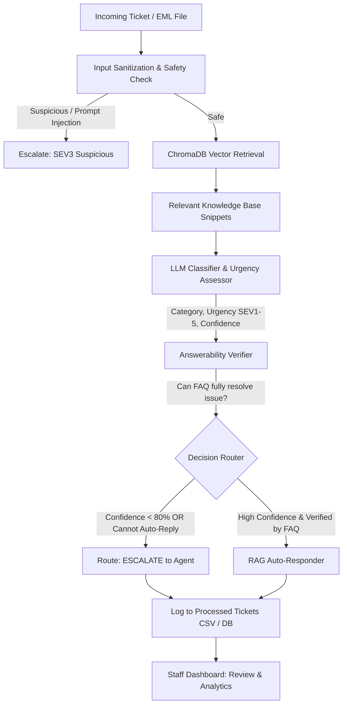

# SupportFlow — AI Support Ticket Triage & Auto-Escalation Engine

An intelligent, production-ready support ticket triage and routing platform designed to ingest incoming customer tickets/emails, classify intent and urgency, verify answerability against internal knowledge base (FAQ) documents, auto-respond to routine inquiries, and dynamically escalate high-severity incidents with strict SLA tracking.

---

## 📌 Executive Summary & Problem Solved

Support teams often struggle with high ticket volumes, delayed response times for critical incidents, and repetitive routine inquiries (e.g., password resets, standard billing queries, tracking updates). 

**SupportFlow** automates the first line of support by:
1. **Accelerating Response Time:** Resolving common, FAQ-covered questions instantly with grounded, hallucination-free AI responses (`AUTO_REPLY`).
2. **Safeguarding High-Severity Incidents:** Accurately identifying critical system outages, security breaches, and urgent customer issues (`SEV1` / `SEV2`), auto-escalating them directly to human agents with prioritized SLAs.
3. **Ensuring Reliability & Safety:** Incorporating prompt-injection guards, confidence thresholds (<80% auto-escalates), and strict answerability checks to prevent incorrect or fabricated responses.
4. **Enabling Human-in-the-Loop (HITL) Quality Control:** Providing support managers and helpdesk agents a rich UI to review triage decisions, override categories/severities, and monitor triage accuracy metrics.

---

## 🏗️ System Architecture & Triage Workflow



### The 6-Stage Pipeline

| Stage | Component | Description |
|---|---|---|
| **1. Safety Guard** | `safety.py` | Detects adversarial prompt injections or override attempts (e.g., *"ignore previous instructions"*). |
| **2. RAG Retrieval** | `vector.py` / `retriever.py` | Embeds the ticket and queries ChromaDB for relevant knowledge base procedures (`billing`, `shipping`, `login`, `password reset`). |
| **3. Intent & Urgency Classifier** | `classifier.py` | Classifies category, assigns urgency (`SEV1`–`SEV5`), confidence score (0–100), and reasoning using Ollama (`llama3.2`). |
| **4. Answerability Verification** | `answerability.py` | Validates whether the knowledge base contains a definitive resolution. If human intervention, database lookups, or account access is needed, auto-reply is disallowed. |
| **5. Policy Router** | `router.py` / `triage.py` | Enforces routing decisions. If non-answerable, lower severity tickets are automatically bumped to `SEV3` (3 days SLA) for human review. |
| **6. Grounded Generation** | `responder.py` | Synthesizes an empathetic, strictly knowledge-grounded customer response with automated disclaimer footers. |

---

## ⚡ Severity Matrix & SLA Enforcements

The engine assigns strict Service Level Agreements (SLAs) based on operational impact and urgency:

| Severity | Impact Level | Target Resolution SLA | Routing Behavior |
|---|---|---|---|
| **SEV1** | **Critical** (System-wide outage, active breach, severe data loss) | **4 Hours** | Immediate escalation to on-call engineering |
| **SEV2** | **High** (Significant business impairment, blocked workflow) | **1 Day** | High-priority escalation to senior support |
| **SEV3** | **Medium** (Standard bug, inquiry requiring human investigation) | **3 Days** | Routed to standard support queue |
| **SEV4** | **Low** (Minor issue, cosmetic bug, general questions) | **4 Days** | Eligible for `AUTO_REPLY` if answerable |
| **SEV5** | **Informational** (Feedback, feature requests, minor docs) | **5 Days** | Eligible for `AUTO_REPLY` if answerable |

> ⚠️ **Escalation SLA Rule:** If a ticket is classified as `SEV4` or `SEV5` but is deemed unanswerable by the knowledge base, SupportFlow automatically promotes the urgency to **`SEV3` (3 days SLA)** to guarantee timely human review.

---

## 💻 Tech Stack

### Backend
- **Framework:** FastAPI (Python 3.10+)
- **LLM Orchestration:** LangChain (`langchain-core`, `langchain-community`, `langchain-ollama`)
- **Local AI Model:** Ollama running LLaMA 3.2 (`llama3.2`)
- **Vector Database:** ChromaDB (`langchain-chroma`, `chromadb`)
- **Data Persistence:** Pandas & CSV audit logs (`output/tickets_processed.csv`)
- **Testing:** Pytest

### Frontend
- **Framework:** React 19 + Vite
- **UI & Icons:** Lucide React, modern reactive CSS
- **Routing:** React Router DOM (v7)
- **Features:** Drag-and-drop `.eml` email parser, live triage visualizer, ticket management list, human-in-the-loop review portal, system analytics.

---

## 📂 Project Structure

```text
supporticketriage/
├── README.md                      # Project documentation and guide
├── backend/
│   ├── api.py                     # FastAPI REST API endpoints & CORS configuration
│   ├── triage.py                  # Core triage pipeline orchestration
│   ├── classifier.py              # Zero-shot LLM classification & severity scoring
│   ├── answerability.py           # Verification step for FAQ resolution feasibility
│   ├── responder.py               # RAG response generator
│   ├── router.py                  # Routing logic (AUTO_REPLY vs. ESCALATE)
│   ├── safety.py                  # Prompt-injection detection
│   ├── vector.py                  # ChromaDB vector store initialization
│   ├── retriever.py               # Similarity retrieval from vector store
│   ├── main.py                    # Standalone batch execution runner
│   ├── evaluate.py                # Pipeline evaluation & accuracy metrics
│   ├── requirements.txt           # Python dependencies
│   ├── knowledgebase/             # Markdown FAQ documents
│   │   ├── billing.md
│   │   ├── login_issues.md
│   │   ├── password_reset.md
│   │   └── shipping.md
│   ├── data/
│   │   └── sample_tickets.csv     # Benchmark dataset for evaluation
│   ├── output/
│   │   └── tickets_processed.csv  # Historical triaged tickets & human feedback logs
│   ├── src/
│   │   ├── kb.py                  # Knowledge base document loader
│   │   └── ticketloader.py        # CSV ticket parser
│   └── test/
│       └── samplerouting.py       # Unit and routing tests
├── frontend/
│   ├── src/
│   │   ├── components/
│   │   │   ├── EmailUploader.jsx  # Drag-and-drop .eml file parser
│   │   │   ├── EmailPreview.jsx   # Parsed email preview card
│   │   │   ├── TriageResult.jsx   # Detailed triage output & badge breakdown
│   │   │   ├── Header.jsx         # App navbar
│   │   │   ├── Sidebar.jsx        # Navigation sidebar
│   │   │   └── LoadingSpinner.jsx
│   │   ├── pages/
│   │   │   ├── TriagePage.jsx     # Live single-ticket triage interface
│   │   │   ├── TicketsPage.jsx    # Tickets log, filtering, and status tracking
│   │   │   ├── TicketDetails.jsx  # Human review, severity adjustments, manual replies
│   │   │   └── AnalyticsPage.jsx  # High-level metrics & accuracy rates
│   │   ├── services/
│   │   │   └── triageApi.jsx      # API client for backend communication
│   │   ├── App.jsx                # Router & root state
│   │   └── App.css                # Application styles
│   ├── package.json
│   └── vite.config.js
└── test_emails/                   # Directory for test .eml files
```

---

## 🚀 Getting Started

### Prerequisites

1. **Python 3.10+** installed.
2. **Node.js (v18+)** and **npm** installed.
3. **Ollama** installed and running locally with the LLaMA 3.2 model:
   ```bash
   ollama run llama3.2
   ```

---

### 1. Backend Setup

1. Open your terminal in the `backend/` directory:
   ```bash
   cd backend
   ```

2. Create and activate a Python virtual environment:
   ```bash
   # Windows (PowerShell)
   python -m venv .venv
   .venv\Scripts\Activate.ps1

   # Linux/macOS
   python3 -m venv .venv
   source .venv/bin/activate
   ```

3. Install required Python packages:
   ```bash
   pip install -r requirements.txt
   ```

4. (Optional) Configure environment variables:
   ```bash
   cp .env.example .env
   ```

5. Start the FastAPI development server:
   ```bash
   uvicorn api:app --reload --host 127.0.0.1 --port 8000
   ```
   The API will be available at: **`http://127.0.0.1:8000`**  
   Interactive API docs (Swagger): **`http://127.0.0.1:8000/docs`**

---

### 2. Frontend Setup

1. Open a new terminal in the `frontend/` directory:
   ```bash
   cd frontend
   ```

2. Install dependencies:
   ```bash
   npm install
   ```

3. (Optional) Configure environment variables:
   ```bash
   cp .env.example .env
   ```

4. Start the Vite development server:
   ```bash
   npm run dev
   ```
   The dashboard will be available at: **`http://localhost:5173`**

---

## 📡 API Reference

### 1. `POST /api/triage`
Triages an incoming support ticket. Runs the 6-stage pipeline and stores the result.

**Request Body:**
```json
{
  "subject": "Can't log into my account",
  "body": "I reset my password but the login screen says invalid credentials."
}
```

**Response (Example - AUTO_REPLY):**
```json
{
  "id": "c1f7a6b2-...",
  "category": "password_reset",
  "urgency": "SEV4",
  "confidence": 92,
  "is_suspicious": false,
  "decision": "AUTO_REPLY",
  "reason": "Matches standard password reset troubleshooting procedure in knowledge base.",
  "response": "Hello, thank you for reaching out. Please make sure to clear your browser cache and follow the password reset link within 15 minutes...",
  "sla": "4 days",
  "retrieved_sources": [".../password_reset.md"]
}
```

### 2. `GET /api/tickets`
Retrieves all triaged tickets, including human review status and responses.

### 3. `PATCH /api/tickets/{ticket_id}/review`
Allows human support agents to submit quality assurance feedback.

**Request Body:**
```json
{
  "analysis_correct": true,
  "corrected_category": null,
  "review_notes": "AI accurately identified the reset issue."
}
```

### 4. `PATCH /api/tickets/{ticket_id}/respond`
Updates severity, records agent notes, and marks the ticket as officially answered.

---

## 🔮 Roadmap & Future Improvements

To transform this into a fully autonomous, enterprise-grade support ecosystem, the following enhancements are planned:

- [ ] **Automated Mailbox Scanning (IMAP / MS Graph / Gmail API):** Background daemon or webhook listener to ingest `.eml` / MIME tickets directly from support inboxes (e.g. `support@company.com`).
- [ ] **Real-time Escalation Alerts:** Integration with Slack, PagerDuty, or Microsoft Teams webhooks whenever a `SEV1` or `SEV2` ticket is triaged.
- [ ] **Customer Memory & CRM Sync:** Cross-reference ticket history with customer profiles (e.g., Zendesk, Salesforce, HubSpot) to assess customer tier (Enterprise vs. Free) during SLA assignment.
- [ ] **Persistent Vector Store:** Transition from in-memory Chroma instance to a persistent Chroma/Qdrant instance with automatic document re-indexing on file change.
- [ ] **Human-Approved Auto-Reply Workflow:** Optional "semi-autonomous" mode where AI drafts replies but requires one-click agent sign-off before emailing the customer.

---

## 📄 License
This project is licensed under the MIT License.
